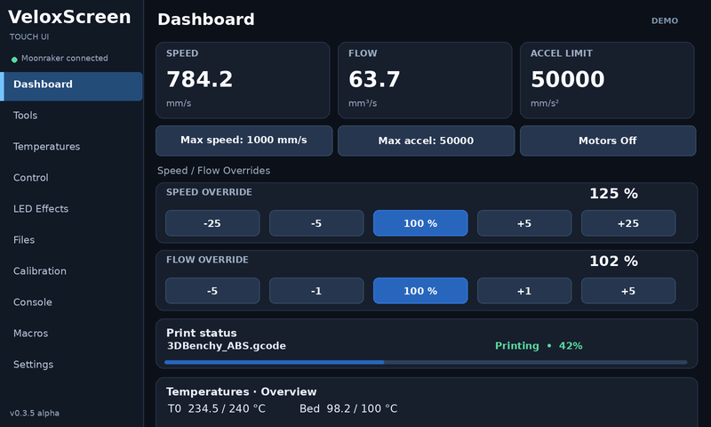
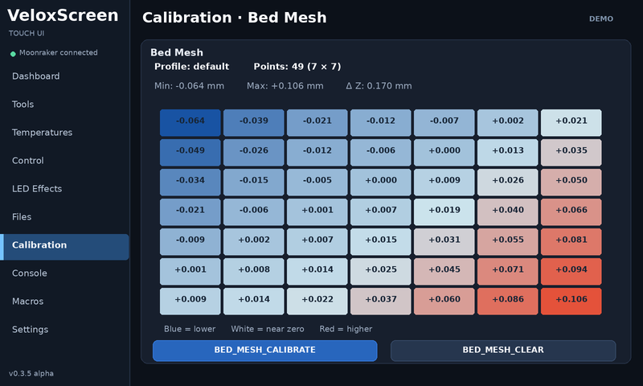

# VeloxScreen


**A native touchscreen interface for Klipper & Moonraker.**  
Responsive layout for small Raspberry Pi touchscreens (experimental 320 × 240 to 1024 × 600). No browser required.

> [!WARNING]
> **Early Alpha (v0.3.9)** — bugs and incomplete features are expected. Test printer controls carefully. Found an issue? **Please open a GitHub Issue!** Feedback and suggestions are welcome.

## Features

- **Print view:** opens automatically when printing starts (optional), with live print progress, actual speed, extrusion flow and acceleration limit, M220/M221 override buttons and fan sliders. An always-confirmed emergency stop uses Moonraker's dedicated emergency endpoint.
- **Navigation:** larger, vertically scrollable sidebar on 800 × 480 and larger displays; compact dropdown navigation on small screens.

- **Network:** Wi-Fi scan, signal, IP address and connection via NetworkManager (experimental, permission-dependent).


- **Dashboard:** live speed, flow, acceleration, M220/M221, temperatures and homing.
- **Printer controls:** tools, heaters, fan sliders, pressure advance and firmware retract.
- **Customization:** unlimited temperature presets, macros, themes and `veloxscreen.conf`.
- **Extras:** Bed Mesh, G-Code console, LED Effects, notifications and animated startup.
- **Languages:** English (default) and German.

## Print view and emergency stop

The **Print** page opens automatically on a new `printing` state. You can switch to any other page without being forced back during the same print. Configure it using:

```ini
[print_view]
auto_open = true
```

**Emergency Stop:** a red button on the Print page always requires confirmation, regardless of normal command confirmation settings. It calls Moonraker `/printer/emergency_stop` directly, not the normal G-Code queue. It immediately puts Klipper into an emergency shutdown state; recovery will be necessary. Do **not** use it for ordinary pause/cancel actions. Only genuine fans (`fan` and `fan_generic`) have writable controls; temperature- and heater-controlled fans are display-only.

## Display scaling

- Detects Qt screen resolution automatically on launch.
- Compact top navigation and stacked controls on narrow displays.
- To override font/UI sizing, set `[display]` → `ui_scale = 1.15` in `~/printer_data/config/veloxscreen.conf` and restart the UI.
- **Early alpha:** 2.8-inch / 320×240 displays have tight controls; keypad and complex edit dialogs may need further work. A screen's physical size cannot be detected reliably from resolution alone.

## Screenshots

*UI previews with simulated printer data — not photos of a running printer.*

| Dashboard | Bed Mesh |
|:---:|:---:|
|  |  |
| **LED Effects** | **Macros** |
|  |  |

[View all screenshots](screenshots/README.md)

## Installation (copy & paste)

**Requirements:** Raspberry Pi 4 / ARM64, Debian 12, Klipper + Moonraker and a working touchscreen. SSH access recommended. **Do not install while printing.**

**First installation** — paste this block into your Raspberry Pi SSH terminal:

```bash
cd ~
sudo apt-get update && sudo apt-get install -y git
git clone https://github.com/N1-3D-Print/VeloxScreen.git
cd VeloxScreen
bash scripts/quick-install.sh
```

Answer the prompts: the installer installs dependencies, sets up X11/systemd, **asks before disabling KlipperScreen**, and offers tty1 autologin (physical-access security tradeoff). KlipperScreen is **not deleted**. No automatic reboot.

Once complete and **no print is running**:

```bash
sudo reboot
```

**Update an already working installation** (does not redo X11/autologin):

```bash
cd ~
[ -d VeloxScreen/.git ] || git clone https://github.com/N1-3D-Print/VeloxScreen.git
cd VeloxScreen
git pull --ff-only
bash scripts/install.sh --skip-deps
```

For custom kiosk/console setups see [Advanced installation](docs/INSTALL.md).

## Mainsail / Moonraker updates (optional)

After installing VeloxScreen from a Git clone, enable one-click updates:

```bash
cd ~/VeloxScreen
bash scripts/setup-moonraker-updates.sh
```

Confirm when prompted, then restart Moonraker **when idle**. The setup saves backups of `moonraker.conf`, adds a lower-case `[update_manager veloxscreen]` section matching `veloxscreen.service`, and makes every VeloxScreen service start copy the latest checked Python code. Existing `veloxscreen.conf` and custom logo remain untouched. See [Moonraker updates](docs/MOONRAKER_UPDATES.md).

## Switch between screens (no uninstall)

**Use VeloxScreen:**

```bash
sudo systemctl disable --now KlipperScreen.service
sudo systemctl enable veloxscreen.service
sudo reboot
```

**Use KlipperScreen again:**

```bash
sudo systemctl disable --now veloxscreen.service
sudo systemctl enable KlipperScreen.service
sudo reboot
```

If you used an older VeloxScreen alpha with an unconditional `startx` autostart, run `bash scripts/migrate-autostart.sh` **before switching**. See [Switching guide](docs/SWITCHING.md). Service names may vary on custom installations.

## Configuration & feedback

- **Config:** `~/printer_data/config/veloxscreen.conf` · [Example](veloxscreen.conf.example)
- **Bug reports / ideas:** open a [GitHub Issue](../../issues) with steps, version and logs (remove private data).
- **Troubleshooting:** [Guide](docs/TROUBLESHOOTING.md)
- **License:** [GPL-3.0](LICENSE)

*Independent community software. Not affiliated with the Klipper, KlipperScreen, Mainsail or Moonraker teams.*
