# VeloxScreen


**A native touchscreen interface for Klipper & Moonraker.**  
Responsive layout for small Raspberry Pi touchscreens (experimental 320 × 240 to 1024 × 600). No browser required.

> [!WARNING]
> **Early Alpha (v0.4.10)** — bugs and incomplete features are expected. Test printer controls carefully. Found an issue? **Please open a GitHub Issue!** Feedback and suggestions are welcome.

## What's new in v0.4.10 Alpha

**Per-tool filament presence:** the Tools page shows a green `Filament present` or red `No filament` status under each mapped extruder, separately from the blue active-tool tile. Disabled, unavailable and unassigned sensors are distinguished. Common per-tool sensor names are detected automatically; use `[filament_sensors]` for exact mappings. Motion-only sensors do not prove filament presence. No extra Moonraker polling or changes to filament macros. See [multi-tool setup](docs/MULTITOOL.md).

### Previous update: v0.4.9

Direct tool changes are enabled by default: tap T0/T1/Tn to request its configured macro. Under **Settings → Confirmation dialogs**, disable direct mode to restore the separate Activate button, and independently choose confirmations for tool changes, extrusion/retract and filament load/unload (including All). Existing G-code confirmation settings are inherited until individually customized. Motion/temperature interlocks and mandatory emergency/recovery confirmations remain in place. Fixed a duplicated `bash` in the kiosk installer.

### Previous update: v0.4.8

**Multi-tool & filament management** expands the Tools page: discover numbered extruders, select and activate tools via existing configured macros, read individual temperatures and invoke discovered Load / Unload / Load All / Unload All macros. The blue tool is the active extruder reported by Klipper, not simply the selected one. Local tracked operations disable repeated tool/filament actions until completion and a fresh status poll. See [multi-tool setup](docs/MULTITOOL.md).

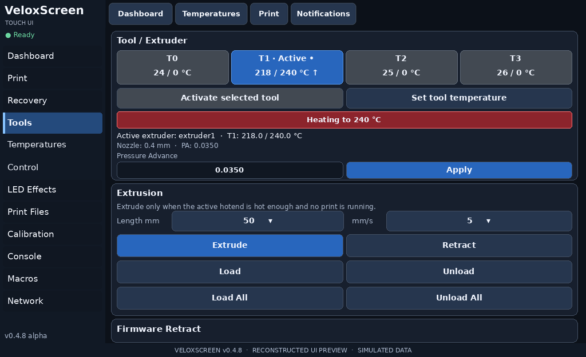

*Reconstructed v0.4.8 preview with simulated data and optional configured macros (separate Activate mode in v0.4.9); not a native Qt capture.*

### Previous update: v0.4.7

**Graphical Exclude Object**: select a part directly in the XY bed view, zoom to the occupied area with **Fit objects**, then confirm exclusion. The view uses Klipper's object polygons, with a named list for missing or overlapping geometry. Blue indicates selection, green indicates the current object and red hatching indicates excluded objects. Exclusion is permanent for the current job.

| Print monitor | Graphical Exclude Object |
|:---:|:---:|
| 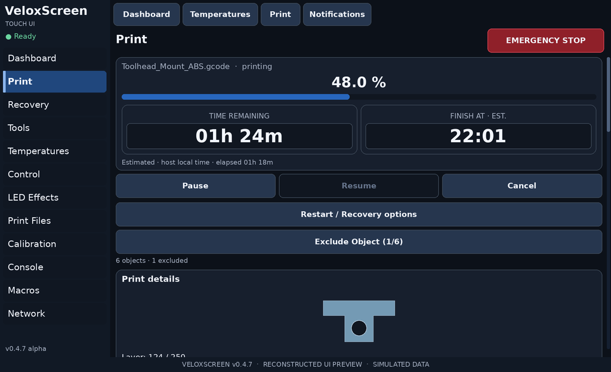 | 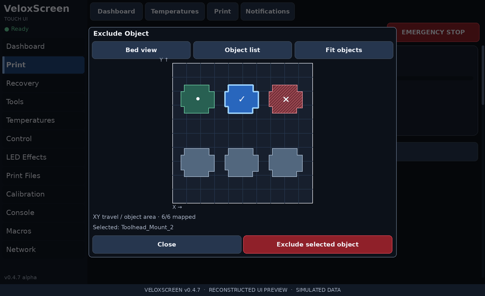 |
| **Toolhead control** | **Print Files** |
| 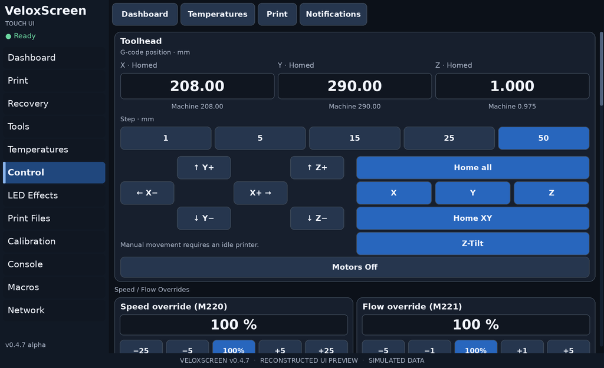 | 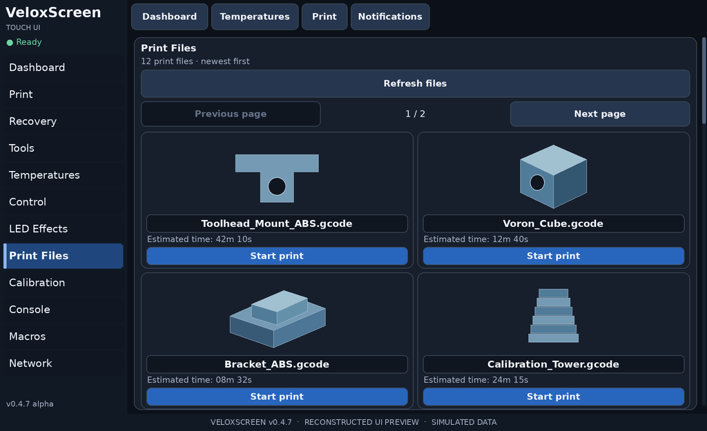 |

*Reconstructed UI previews based on v0.4.7 source code with simulated data; not native Qt captures or photos of a running printer. Actual layout varies by screen size, theme and printer configuration.*

## Features

| Area | Highlights |
|---|---|
| **Print monitor** | Prominent estimated time remaining and finish-at clock, progress, thumbnail, layers, filament usage, active tool and Pause / Resume / Cancel. Optional automatic Print page on job start. |
| **Live print controls** | Speed and flow overrides (M220/M221), actual motion metrics, editable heater targets, manual fans, live Z-offset and temperature history. |
| **Print Files** | G-code-only thumbnail cards, filename, folder and estimated duration where available. Six files per page, newest first, background preview loading and confirmed print start. |
| **Graphical Exclude Object** | Tap true object polygons, fit the occupied area, inspect current/excluded states, confirm exclusion. Named-list fallback. |
| **Toolhead control** | Live XYZ G-code and machine positions, directional jog, visible step buttons (50 mm default), Home all/XY/X/Y/Z, homing animation and Motors Off. Z-Tilt and QGL when detected. |
| **Temperature management** | Multi-hotend, bed and generic heater support; red heating, green at target, amber cooling; active preset highlighting based on live targets. |
| **Babystepping** | 0.005 / 0.010 / 0.025 / 0.050 mm steps; optional confirmed permanent Z calibration save on supported single-tool systems after print completion. |
| **Customization** | Reorder blocks, navigation, fans, sensors, macros and presets; choose quick actions and theme colors; adjust UI scale and language (English / German). |
| **Display comfort** | Idle dim/blank, keep-on-print, optional hardware backlight/DPMS, font/button sizing, startup page, dot cursor and slide-to-unlock cleaning lock. |
| **Notifications** | Local optional history of up to 150 events, category filters and individual popup preferences. |
| **Safety and recovery** | Fixed compact Emergency Stop on Dashboard and Print, original Klipper fault text, confirmed firmware restart / Klipper restart / host reboot, separately guarded host shutdown. |
| **Multi-tool / filament** | Automatic extruder discovery, explicit tool activation, individual targets, existing filament macros and guarded operations. |
| **Other controls** | Extrusion, pressure advance, firmware retract, bed mesh, G-code console, LED effects, macro visibility, experimental NetworkManager Wi-Fi. |

### Object exclusion requirements

Add `[exclude_object]` to your Klipper configuration if it is not already present, and enable object labeling/exclusion in your slicer or Moonraker object processing as appropriate. The map uses reported XY travel limits, which may include IDEX parking space; it is not a measured plate outline. Center-only objects use point markers. Object selection does not send G-code; the separate confirmation does.

### Homing and Z-offset notes

Homing buttons are grey until their axes are reported homed, then blue. Locally requested homing displays an animated busy indicator and blocks repeated motion until the command result and fresh status are received. External homing updates the reported axis states. Jog requires an idle printer and the relevant homed axis; choose a smaller step near limits. Permanent Z-offset saving is restricted to supported, unambiguous single-tool calibration methods. Eddy scan/tap requires explicit configuration; custom multi-tool offsets are not automatically saved. **Save after print** is a reminder, not an automatic SAVE_CONFIG. See [Z-offset guide](docs/Z_OFFSET.md).

## Customize the layout

Open **Settings → Customize layout → Edit layout**. Choose a category, select an item and tap **Up / Down**, or enable **Drag mode** to reorder by dragging. **Save layout** applies changes without restarting; **Reset order** restores the selected category's defaults when saved.

Dashboard, Print, Control, Tools, Temperatures, Macros and Settings support block ordering. Navigation, fans, heater/sensor tiles, macro buttons and temperature presets have shared item orders. Print still shows only `fan` and `fan_generic`; its status, emergency stop and recovery controls stay fixed. The Dashboard emergency stop and printer fault banner also stay fixed. This is responsive ordering, not free-pixel placement or resizing. New items are appended automatically. All settings remain in `veloxscreen.conf`.

## Print view and emergency stop

The **Print** page opens automatically on a new `printing` state. You can switch to any other page without being forced back during the same print. Configure it using:

```ini
[print_view]
auto_open = true
```

**Print temperatures:** view actual and target temperatures for every discovered hotend, bed and generic heater. Tap the target to edit it using the touch keypad. Chamber sensors are read-only; heater editing requires reported limits and live data.

**Emergency Stop:** a compact red button fixed at the top right of both Dashboard and Print always requires confirmation, regardless of normal command confirmation settings. It calls Moonraker `/printer/emergency_stop` directly, not the normal G-Code queue. It immediately puts Klipper into an emergency shutdown state; recovery will be necessary. Do **not** use it for ordinary pause/cancel actions. 

**Print fans:** only `fan` and `fan_generic` objects are shown, with manual speed controls. `temperature_fan`, `controller_fan`, `heater_fan` and other automatic fans are hidden on Print. The general Control page is unchanged.

## Quality of life

Open **Settings → Display comfort**, **Quick actions**, and **Notification preferences** to customize the new features. Time remaining is estimated from slicer metadata and measured progress, not guaranteed; while paused, finish time is deliberately withheld. Layer information and preview depend on the sliced file and Klipper metadata. Optional grams use the configured material density. The display can dim/blank in software even without backlight support. Physical power management is opt-in and driver-dependent. The cleaning lock requires confirmed idle state and unlocks by a deliberate drag; a new print or fault releases it. See [Quality of life guide](docs/QUALITY_OF_LIFE.md).

## Display scaling

- Detects Qt screen resolution automatically on launch.
- Compact top navigation and stacked controls on narrow displays.
- To override font/UI sizing, set `[display]` → `ui_scale = 1.15` in `~/printer_data/config/veloxscreen.conf` and restart the UI.
- **Early alpha:** 2.8-inch / 320×240 displays have tight controls; keypad and complex edit dialogs may need further work. A screen's physical size cannot be detected reliably from resolution alone.

## More UI previews

| Dashboard | Live heating & presets |
|:---:|:---:|
| 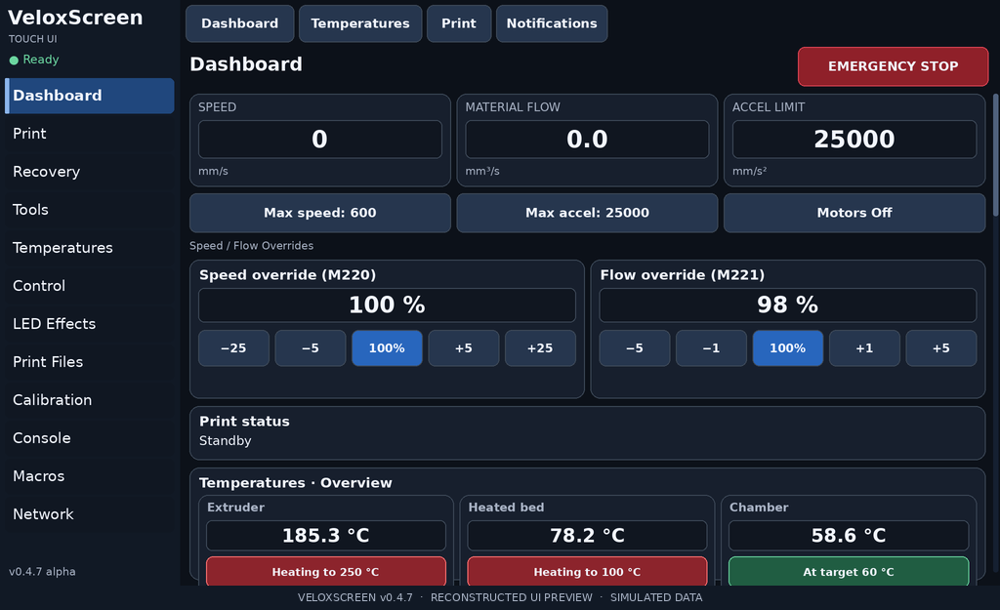 | 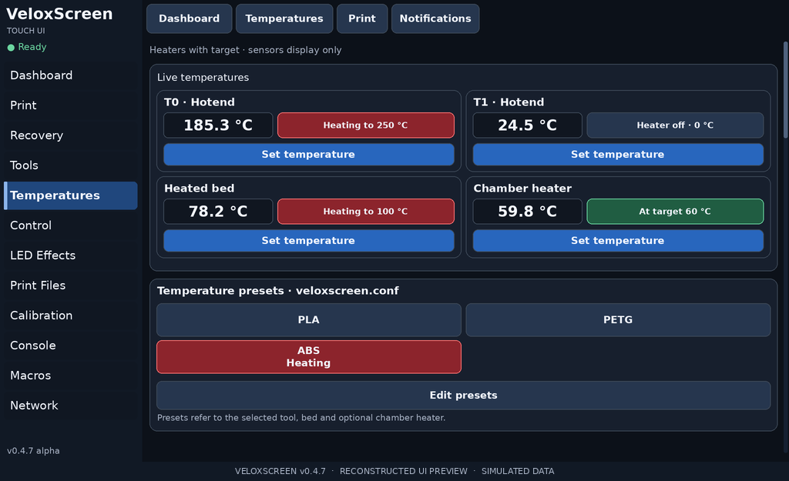 |
| **Notification center** | **Custom layout** |
| 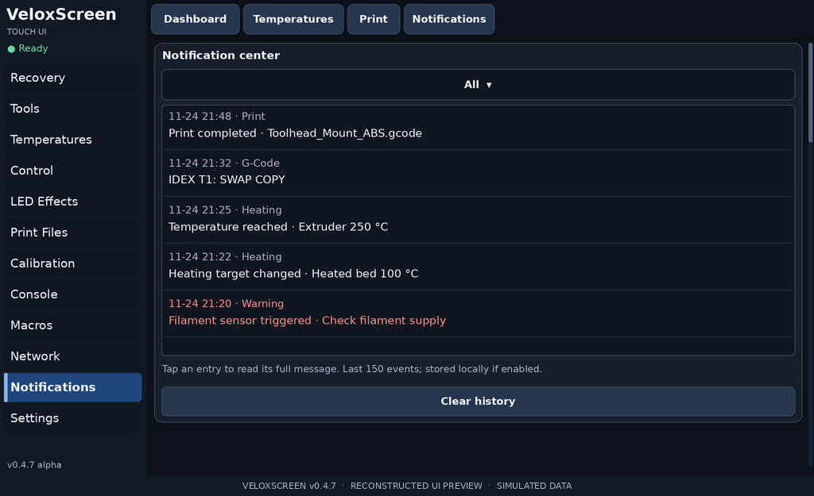 | 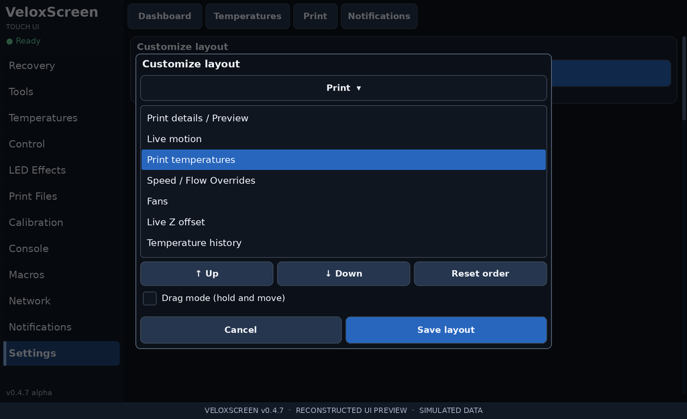 |
| **Recovery** | **Cleaning lock** |
| 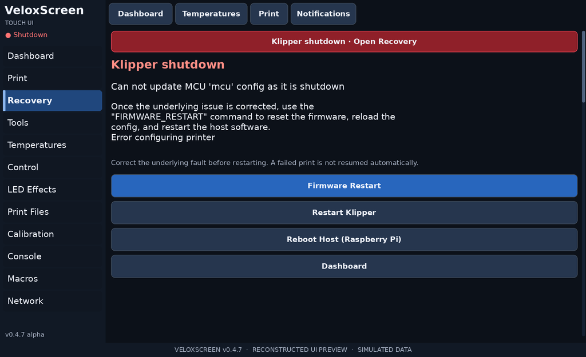 | 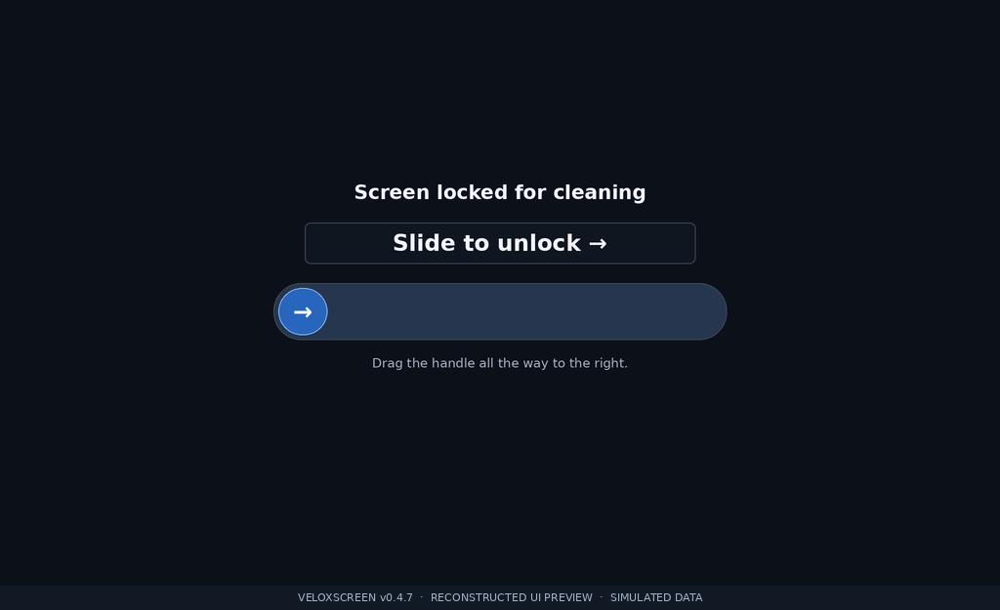 |

[Full preview gallery](screenshots/README.md) · [Release history](CHANGELOG.md)

## Installation (copy & paste)

**Requirements:** Raspberry Pi 4 / ARM64, Debian 12, Klipper + Moonraker and a working touchscreen. SSH access recommended. **Do not install while printing.**

**First installation** — paste this block into your Raspberry Pi SSH terminal:

```bash
cd ~
sudo apt-get update && sudo apt-get install -y git
git clone https://github.com/N1-3D-Print/VeloxScreen.git
cd VeloxScreen
bash scripts/quick-install.sh
```

Answer the prompts: the installer installs dependencies, sets up X11/systemd, **asks before disabling KlipperScreen**, and offers tty1 autologin (physical-access security tradeoff). KlipperScreen is **not deleted**. No automatic reboot.

Once complete and **no print is running**:

```bash
sudo reboot
```

**Update an already working Git installation** (does not redo X11/autologin):

```bash
cd ~/VeloxScreen
git pull --ff-only && bash scripts/install.sh --skip-deps
```

For custom kiosk/console setups see [Advanced installation](docs/INSTALL.md).

## Mainsail / Moonraker updates (optional)

After installing VeloxScreen from a Git clone, enable one-click updates:

```bash
cd ~/VeloxScreen
bash scripts/setup-moonraker-updates.sh
```

Confirm when prompted, then restart Moonraker **when idle**. The setup saves backups of `moonraker.conf`, adds a lower-case `[update_manager veloxscreen]` section matching `veloxscreen.service`, and makes every VeloxScreen service start copy the latest checked Python code. Existing `veloxscreen.conf` and custom logo remain untouched. See [Moonraker updates](docs/MOONRAKER_UPDATES.md).

## Switch between screens (no uninstall)

**Use VeloxScreen:**

```bash
sudo systemctl disable --now KlipperScreen.service
sudo systemctl enable veloxscreen.service
sudo reboot
```

**Use KlipperScreen again:**

```bash
sudo systemctl disable --now veloxscreen.service
sudo systemctl enable KlipperScreen.service
sudo reboot
```

If you used an older VeloxScreen alpha with an unconditional `startx` autostart, run `bash scripts/migrate-autostart.sh` **before switching**. See [Switching guide](docs/SWITCHING.md). Service names may vary on custom installations.

## Configuration & feedback

- **Config:** `~/printer_data/config/veloxscreen.conf` · [Example](veloxscreen.conf.example)
- **Bug reports / ideas:** open a [GitHub Issue](../../issues) with steps, version and logs (remove private data).
- **Troubleshooting:** [Guide](docs/TROUBLESHOOTING.md)
- **License:** [GPL-3.0](LICENSE)

*Independent community software. Not affiliated with the Klipper, KlipperScreen, Mainsail or Moonraker teams.*
