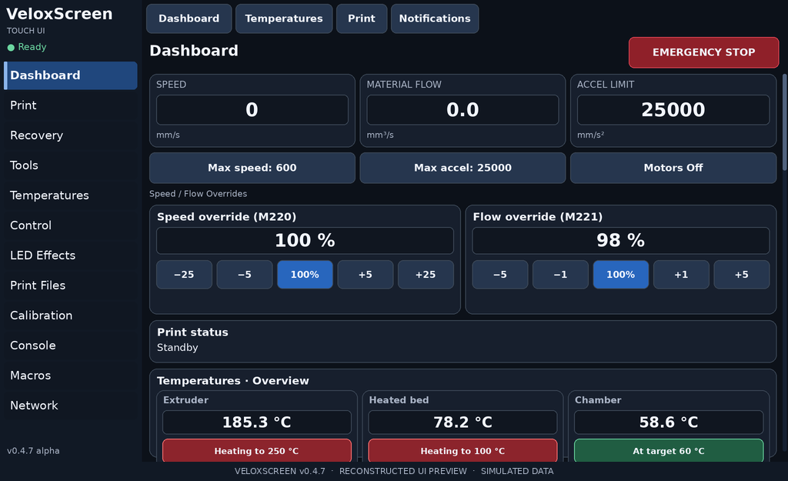
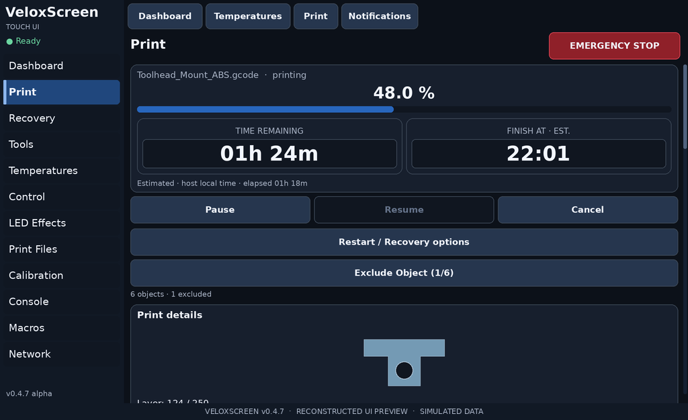
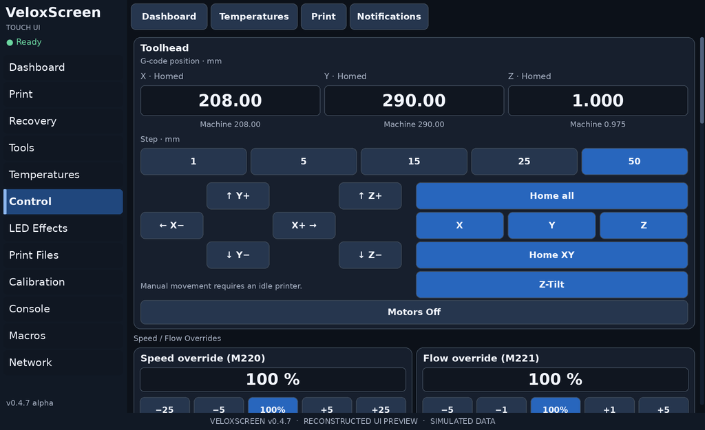
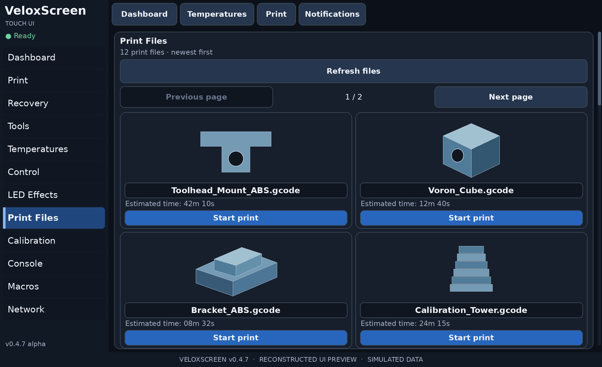
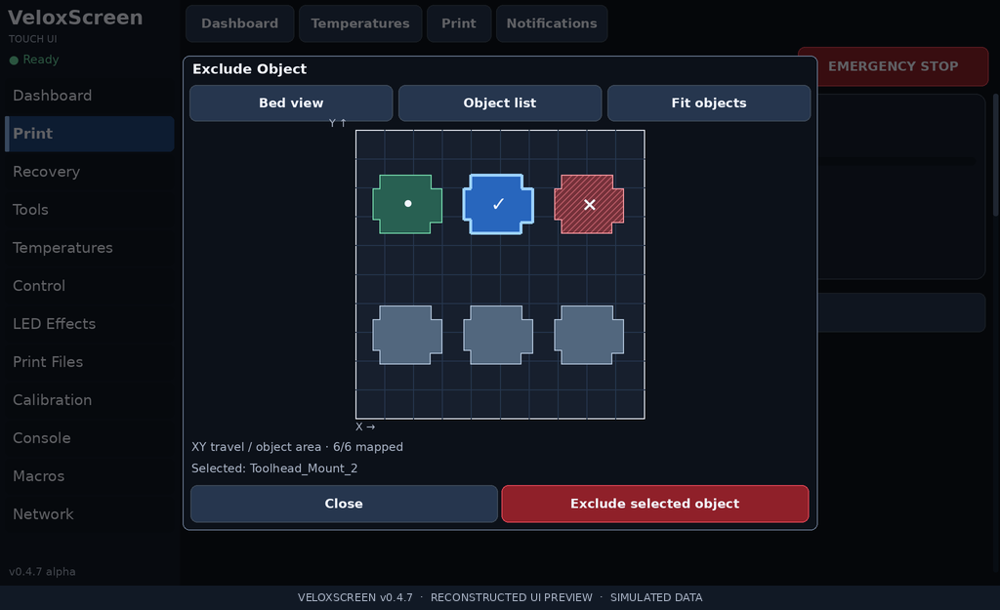
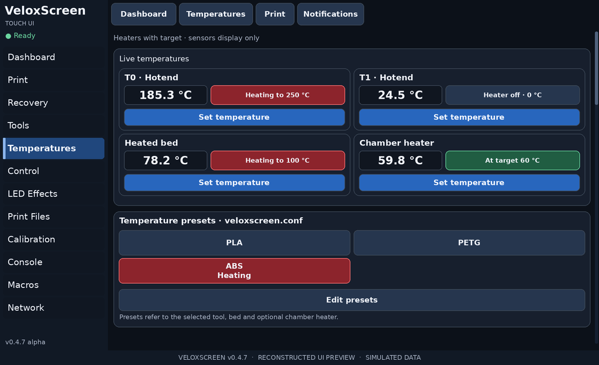
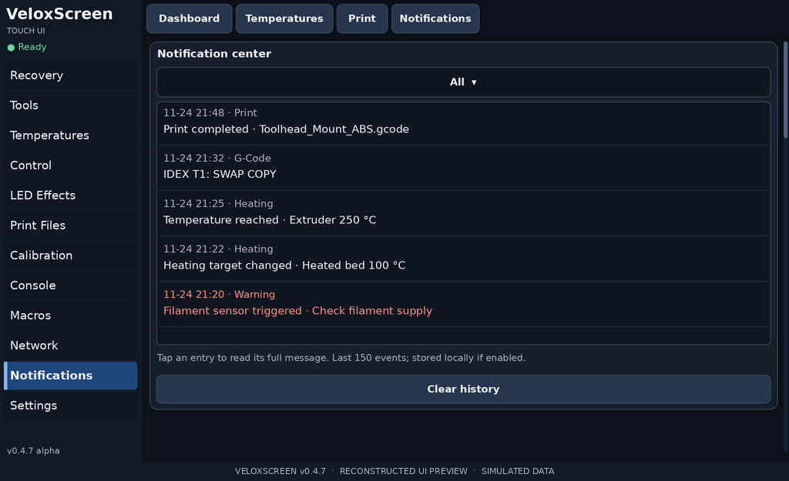
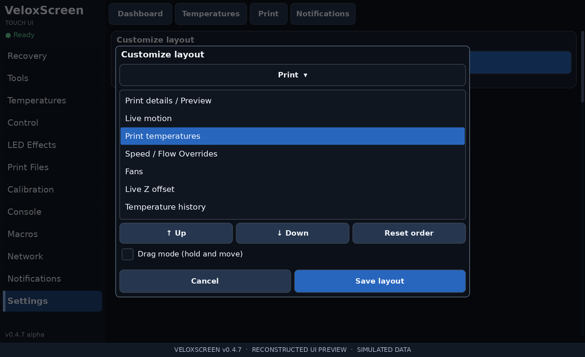
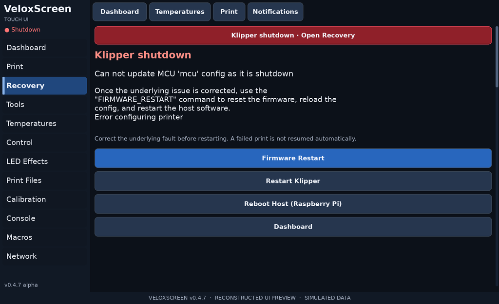
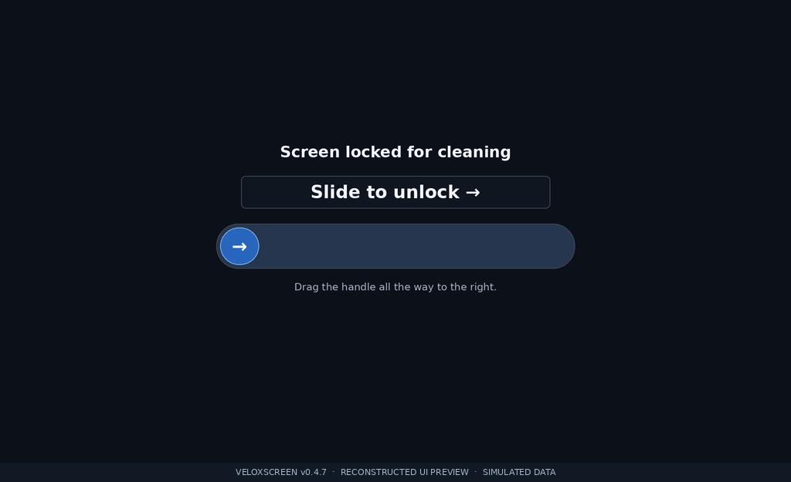

# VeloxScreen v0.4.7 Alpha — UI previews

These 1024 × 600 layout reconstructions use the actual v0.4.7 source structure, controls and default palette with simulated printer data and illustrative thumbnails. They are **not native Qt screenshots or connected-printer captures**. Exact dimensions and scrolling vary by device and configuration.

[Back to project README](../README.md)

## Dashboard

Live motion, overrides, compact emergency stop and temperature overview.

## Print Monitor

Large remaining time and estimated finish clock, print actions and preview.

## Toolhead Control

XYZ coordinates, 50 mm default step, jog and homing.

## Print Files

Thumbnail-based G-code browser; illustrative sample models.

## Graphical Exclude Object

XY bed map, current/selected/excluded polygons and fit control.

## Temperatures

Live targets and preset highlighting.

## Notification Center

Categorized local event history.

## Customize Layout

Reorder functional blocks with arrows or drag mode.

## Recovery

Original error message and recovery actions.

## Cleaning Lock

Slide-to-unlock touch cleaning mode.

